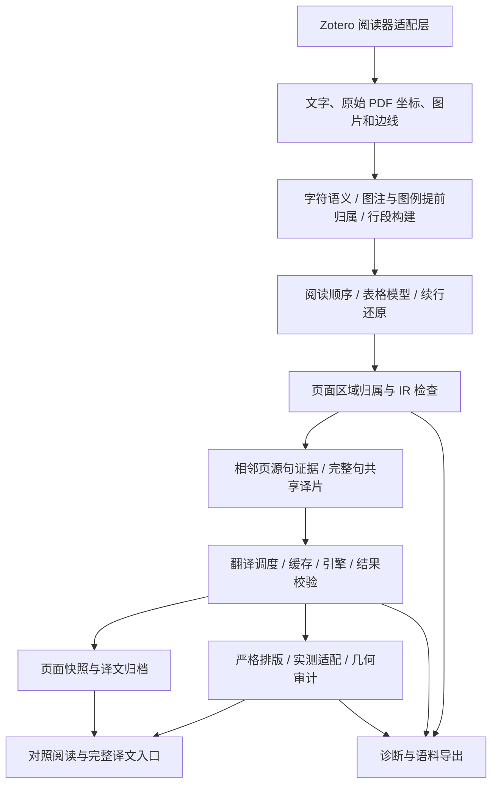

# PaperMirror 4.7.0 架构

本文对应 4.7.0 的实际代码。框架围绕“保存原文结构、翻译内容、在边界内显示”组织；区域归属是约束与诊断信息，不是新的翻译过滤条件。4.7 在既有链路中补充字符语义、跨栏跨页完整源句和图例标记归属，不引入新的阅读模式或外部排版服务。

## 主链路

## 适配与会话

- `src/reader/zoteroReaderAdapter.ts` 隔离 Zotero 非公开阅读器接口。官方 Reader、Prefs、HTTP 等 API 可直接使用。
- `src/reader/readerSession.ts` 管理一个阅读器标签页的视图、提取器、翻译管理器、滚动同步与资源释放。
- 引导层安装沙箱所需的兼容设施。切换视图与恢复页面显示不应要求重新请求翻译接口。

## 提取与结构

`src/reader/textExtractor.ts` 按可用性尝试字符接口、PDF.js `getTextContent`、文本层；纯文本回退不具备可靠的逐块版面几何。不同路径共用段落与结构处理，但证据丰富程度不同。

`spanBlockBuilder.ts`、`blockBuilder.ts` 和 `paragraphHeuristics.ts` 将字符或跨度组成行、段落与栏位。`captionOwnership.ts` 在普通段落合并前识别有充分标签和行对齐证据的图注。`twoColumnTable.ts` 同样在散文分组前认领带表题、双表头、重复左侧标签和右侧连续说明的两列表格；标签换行仍属同一行，点状分隔线只作为装饰。`tableBorders.ts` 与 `tableStructure.ts` 提供边框/文本表格结构；`src/ir/tableModel.ts` 描述单元格及其对应关系。

`semanticSpans.ts` 根据相邻字形的基线、大小和位置表达上下标语义，避免把上标数字直接接成普通整数或误当成跨栏跨度；不依据特定论文、数字或单位命中。`embeddedFontSymbols.ts` 与 `symbolFontSemantics.ts` 结合实际嵌入字体的简单字形证据恢复部分关系符号；字体名或表面字符名不足以授权替换。

`legendItems.ts` 在普通行段构建前，以至少三个重复、对齐的短水平标记及其相邻文本建立独立图例条目。每项保留自己的行矩形、字号和 `SourceRegion(kind='legend-item', evidence='marker-aligned-lines')`。原 PDF 继续绘制标记和颜色，提取层不识别或重画颜色。完整源文行用于估计栏位，图例不能以缺失栏标记使整页阅读顺序退回输入顺序。两项、光栅标记、冲突或其他证据不足的图例保留既有路径；矢量路径暂时不可用时允许后续重新取证。

`pageRegions.ts` 在现有续行还原后分配正文栏、单元格、页眉页脚和其余图注的 `SourceRegion`。`bodyColumnContinuity.ts` 只在已有可信正文栏和局部几何支持下恢复窄片段的栏归属，再由既有同栏合并还原源文顺序；不会跨栏合并覆盖矩形。提前给临时栏位的碎片固定归属会破坏正常续行，因此正文归属晚于该还原步骤；图注和图例的显式提前归属仍阻止跨区域合并。

归属包括 ID、类别、原始 PDF 坐标边界和证据来源。单元格边界来自表格模型；已明确归属的表格不会再次使用同一区域的粗边框给剩余脚注建格。同页空间独立的其他网格仍参与识别。正文分带结合既有栏位及跨栏区域，并允许少量受其他原文边界限制的下方空白。未获得可靠坐标的块不能凭空补造几何。`documentIR.ts` 审计 ID、阅读顺序、表格及区域契约；运行期审计并不等于自动修复。

图例条目不参与边框或文字表格候选，不污染正文基准字号，也不参与正文续句图。IR 进一步检查图例没有变成表格单元格、没有失去标记证据，且每条源文行仍位于所属矩形内。来源边界随结构缓存和页面归档的 JSON 序列化保留。

## 翻译与状态

`src/translation/translationManager.ts` 负责请求计划、并发、取消、重试、缓存及结果校验。结构类别不自动等于保留原文：是否请求、引擎是否完成翻译、译文是否放得下必须分别记录。

- `restoreForDisplay` 从已有状态恢复显示，独立于请求调度。
- 取消未完成任务时保留已完成的译文；补译处理缺失部分。整页刷新取消该页旧的主任务、压缩任务和段落重译；段落任务在请求后、落盘前检查取消信号与当前状态身份，过期结果不能回写界面或缓存。
- 页面缓存写入明确报告是否成功。写入失败或缺少缓存身份时，不把内存状态标成已持久化；成功返回还须与同一页面及内容修订一致，并且仍是该状态的最新写入，才能允许冷页淘汰；压缩写入不触发整页重绘时也适用这一约束。磁盘异常不应把成功翻译改成失败，也不能释放唯一内容。
- 缓存命中取决于语言、引擎、模型、提示词和源内容等身份信息，结构缓存有独立版本。
- `displayRestores`、`supplementBlocks`、`repeatedBlockSubmissions` 分别记录恢复、补译及重复提交。重复提交可能来自重试或取消后的续传，不能直接等同于浪费。
- `src/export/pageArchive.ts` 保留页面内容与译文快照；语料和诊断用于区分提取、保留、校验拒绝与排版失败。含原文与译文的临时归档目录在写入前尝试收紧为 0700，归档文件写入后尝试收紧为 0600；平台权限能力不足时不绕过系统 ACL。

`sourceContinuity.ts` 从完整源文顺序取得可信正文的跨栏或相邻物理页续句证据，处理缩写、小数及章节边界；不把图注、图例、表格或页眉页脚当作正文句子。未知、歧义或超出有界长度的边界保守退出。相邻页仅提供源文，不为取得上下文启动相邻页翻译。

大模型服务路径经过 `continuationRequest.ts` 和 `continuationUnitStore.ts`：完整源句只生成一次译文，再按顺序保存全部译片。两页不能各自生成后丢掉借用片段；整句译片持久保存并确认后，父页面译文才可独立持久保存。并发等待者共享同一结果，新的会话实例可恢复同一组完整译片。缺片、重复标识、占位符、数字或单位异常继续拒绝；允许语言语序调整不等于放宽数字和受保护字面量的片段归属校验。

源句上下文、语言和相关服务配置进入缓存身份，单独片段与共享完整句使用各自缓存契约。单段重译复用同一完整句结果以维持两端一致，不独立生成其中半句。免费 Google/Bing 与 DeepL 保留逐块服务契约，不能由大模型路径的通过推断其跨页语义也已验收。

## 排版与显示

对照页的核心是 `src/ui/strictPageReplacement.ts`。它在原页图像上按原文行遮罩，利用真实文字测量适配译文；绕图使用安全区域，单元格采用提取期边界。正文不横向侵入栏间距，下方适配同时受区域、图片、其他文字和底图墨迹限制。图注、图例与单元格不使用普通正文的扩边策略。

图例保留自身字号与固定首行锚点。图例文字遮罩裁在其源文归属内，并向位图像素网格内侧取整，避免亚像素抗锯齿把遮罩泄漏到邻近彩线端点；无法放置时整项保留原文，不能借用另一条颜色的空间。浏览器受控绘制的颜色像素回归与实际 PDF 的原生颜色验收是两份独立证据。

最终几何检查处理重叠与图片侵入。无法放置时保留完整译文和失败原因，交由完整译文入口查看；不能用截断或覆盖相邻内容伪装完成。几何通过也不能证明语义归属正确，已混合的源块仍需在提取阶段修复。

覆盖模式通过会话提供的页面渲染器复用严格排版核心，但宿主挂载、交互与生命周期不同，不能用对照页测试宣称覆盖模式同样完成真机验证。页面同步按页与页内位置处理，显示恢复和引擎请求分别调度。

## 选择、深度解析与阅读模式

解析由会话统一调度，但它的可视容器独立于翻译页面。`autoExplainSelection.ts` 仅观察原文文本层选区，在拖动结束、文本稳定后触发；设置、隐私确认、窗口可见性及服务配置共同决定是否请求。新选区取消过期的自动请求，手动解析先抑制当前选区的自动触发，避免双击产生的单词选区覆盖整段解析。

页面翻译与深度解析共用端点准入检查。开启 `localOnlyMode` 后仅允许 `localhost`、`127.0.0.1` 或 `[::1]` 回环端点；自动解析不向被禁止的云端地址派发请求，手动操作保留可读的配置反馈。设置变化取消现有解析，等待服务配置和结果提交时仍检查请求身份与端点策略。

覆盖模式中原生双击会选择单词，特别是悬停揭示原文后事件落在 PDF 文档而非译文节点上。会话使用页面编号和点击位置，经 PDF 视口坐标转换匹配源段落；命中后明确传入整段源文。译文双击也直接选择对应源块。

`splitView.ts` 提供覆盖界面的浮动解析宿主；`TranslationPane` 将同一张卡片路由到覆盖宿主或对照面板。显示解析不会改变阅读模式、分栏或页面滚动位置。主文档和 PDF 文档共同监听外部点击与 Esc；用户关闭卡片时会话取消待完成请求，结果返回前还须通过请求身份与存活性检查，避免异步重开。关闭或销毁会清理两处文档监听。

公式保护在发送给引擎前进行，必须完整保护公式或完整保留原数值。普通说明中的 `≈33.6`、`≈31.08` 不得只掩蔽整数部分；以 `.75` 开头的公式数值也必须保持完整。统计保护还保留数值的正负号、前导小数点、科学计数法指数，以及置信区间两端的完整数值；样本量和统计值后面的句子标点不属于占位符。格式证据不足的本地化数字保持原文连续，避免只保护其中一部分。保护规则不承诺修正引擎自身的全部数值错误。

`numericPowers.ts` 和 `technicalUnits.ts` 保护有显式 Unicode 上标证据的数字幂及限定的高风险技术单位，区分能量 `keV` 与管电压 `kVp`，并检查数值与单位对应；普通词语或扁平数字不能仅凭猜测改写为单位或幂。共享源句完整性失败的诊断仅记录固定类别与片段索引，不记录源文、译文或数值清单。

## PDF 导出

`src/pdfgen/` 使用 pdf-lib 生成 PDF，属于独立输出路径。导出采用显式区域归属：表格单元格使用自身矩形中的可用空间，正文和图注的适配不得越过来源区域；遮罩和最终字形边界同时受约束。无效归属或无法完整放置时保留原文，不先擦除原文再绘制被裁切的译文。显式保留的公式、数据等内容不因遗留缓存中存在译文就重新进入绘制。

内置字体、字形覆盖和坐标转换有自己的约束；浏览器排版通过不代表导出逐像素一致。生成、写入和导入属于同一次输出操作，无论写入、导入是否成功都尝试清理临时 PDF；清理接口异常不改变原操作的成功或失败状态。正式发布前的 XPI 检查验证清单、版本和资源允许列表，不能代替真实 PDF 导出验收。

## 测试与演进顺序

1. 类型检查与单元测试：结构、缓存、取消、归属和安全边界。
2. 41 页真实跨度语料：分段快照、全文字符清单、IR 及请求计划基线。
3. 浏览器回归：保存的真实译文在多种缩放下检查完整性、放置率和最终几何；超长受控译文单独验证边界。
4. 真实 PDF 交叉检查：同一输入开启和关闭图例识别，比较源文、数字、行矩形及非目标结构；这不能代替完整原始字形正确性证明。
5. Zotero 真机：检查目标语义、颜色对应、实际译文与覆盖探针；复杂表格、长文往返滚动、覆盖模式、导出与自动更新仍按各自范围验收。
6. XPI 构建检查与 GitHub 发布资产验证。

4.7 已补局部栏归属、完整源句共享和标记对齐图例证据。后续仍应优先检查未明确归属的复杂版面、语义对应及真机回归，而非放宽覆盖边界。当前栏位与图例候选仍来自有界启发式；区域联合框和几何零违例不是语义正确性证明。本版不引入视觉模型、OCR 或外部排版服务，也不宣称全部复杂版式已解决。

4.7.0 的具体检查范围、尚待完成的实机项目及既有浏览器数量门槛问题见 [发布验证记录](RELEASE-4.7.0-VALIDATION.md)。
